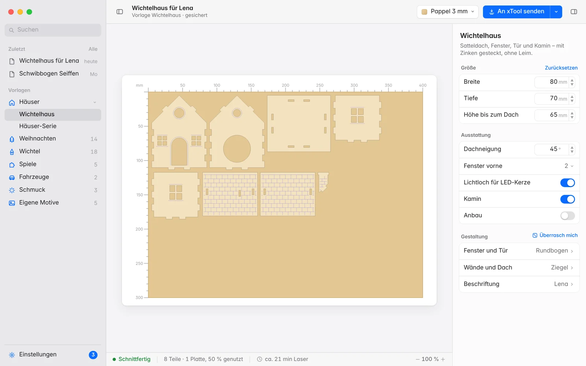

# Steckwerk

[Deutsch](README.md) · **English** · [Website](https://chr-braun.github.io/steckwerk/)

Steckwerk draws laser-cut templates for your exact material thickness and laser: elf houses, Christmas
ornaments, games, candle arches, slot-together vehicles and much more. Every file is checked before it is
written. What passes fits on the first cut.

Made for the **xTool M2** with xTool Creative Space, and as SVG for any CO2 or diode laser.

## Download

| | |
|---|---|
| **Steckwerk Desktop** (recommended) | The native Mac app for macOS 14 or later, Apple silicon and Intel. Download `Steckwerk-Desktop-…-macOS.zip` from [Releases](https://github.com/chr-braun/steckwerk/releases/latest), unzip it and move it to Applications. |
| **Browser version** | For Windows, Linux and older Macs. Needs Python 3.8 or later: get the repo, then run `python3 webui.py`. |
| **Command line** | `python3 cli.py --model wichtelhaus --thickness 3 --kerf 0.15` – all options in the [command line reference](docs/wiki/Kommandozeile.md) (German). |

On first launch macOS blocks the app because it doesn't come from the App Store. Open
**System Settings → Privacy & Security** and click **Open Anyway**. After that Steckwerk tells you about new
versions and packages on its own.

## What Steckwerk does

- **Checked before cutting:** joints, kerf, minimum bridges, closed outlines and sheet size. If there is a single
  error, nothing is written.
- **Straight to your xTool:** finished projects for xTool Creative Space (`.xcs`, layers for cutting and scoring)
  and xTool Studio (`.xs` with laser settings), plus SVG for any other laser.
- **Material profiles** for poplar, birch, MDF and acrylic from 1.5 to 4 mm, with cutting time and material cost.
- **Your own engraving** on every model: photos, logos, your own motifs and 18 surface patterns.
- **Assembly guide** as a PDF; part numbers can be engraved along.
- **German and English**, runs entirely on your computer, with no account and no cloud.

## Theme packages

Install packages in Steckwerk under **Settings → Packages** with one click. Basics comes along with every package.

| Area | Package | What’s inside |
|---|---|---|
| Seasons and holidays | Christmas | Tree ornaments, name ornaments in script, nativity set, sleigh, lace ornaments |
| | Elves | Elf door, furniture, elf room, elf market, fireplace, clock, Christmas tree |
| | Halloween | Haunted castle, pumpkin lantern, gravestone, spider web, skeleton jumping jack, candy bowl |
| Home and gifts | Home | Picture frames, ornamental frames, door sign |
| | Jewellery | Earring pairs in ten shapes |
| | Multi-layer | Cut pictures with four scenes, layered motifs, clip-on decorations |
| Play and motion | Games | Nine men’s morris, tic-tac-toe, four in a row, marble maze, peg solitaire, jigsaw puzzle |
| | Motion | Jumping jack, crank animal, acrobat, spinning top, balancing bird |
| Shapes and art | Shapes | Rib sculptures, wave surfaces, stacked vases |
| Shop and market | Shop | Bottle price tags with logo and unit price |
| Basics | Basics | Ornaments, border strips and the fit test for the right kerf |

The grouping lives in [`paketquellen/bereiche.json`](paketquellen/bereiche.json), the sources of all packages in
[`paketquellen/`](paketquellen). Build your own packages with the [package standard](PAKETE.md) (German).

## Documentation

- [Wiki](docs/wiki/Home.md) (German): installation, usage, models, material and laser, packages, updates
- [What’s new](CHANGELOG.en.md)
- [Contributing](CONTRIBUTING.md)

## License

[MIT](LICENSE)
