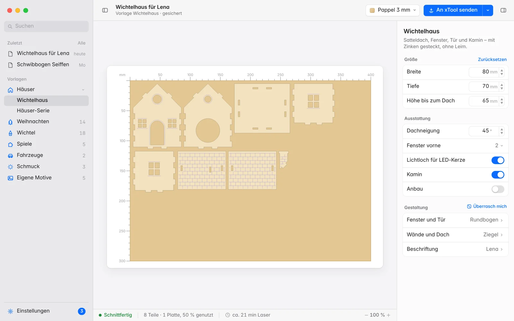

# Steckwerk

**Deutsch** · [English](README.en.md) · [Webseite](https://chr-braun.github.io/steckwerk/)

Steckwerk rechnet Lasercut-Vorlagen genau für deine Materialstärke und deinen Laser: Wichtelhäuser,
Christbaumschmuck, Spiele, Schwibbögen, Steckfahrzeuge und vieles mehr. Jede Datei wird geprüft, bevor
sie geschrieben wird. Was durchgeht, passt beim ersten Schnitt.

Gemacht für den **xTool M2** mit xTool Creative Space, als SVG aber für jeden CO2- und Diodenlaser.

## Laden

| | |
|---|---|
| **Steckwerk Desktop** (empfohlen) | Die native Mac-App ab macOS 14. Unter [Releases](https://github.com/chr-braun/steckwerk/releases/latest) die Datei `Steckwerk-Desktop-…-macOS.zip` laden, entpacken und in den Programme-Ordner ziehen. |
| **Browser-Oberfläche** | Für Windows, Linux und ältere Macs. Braucht Python 3.8 oder neuer: Repo laden, dann `python3 webui.py`. |
| **Kommandozeile** | `python3 cli.py --model wichtelhaus --thickness 3 --kerf 0.15` – alle Optionen unter [Kommandozeile](docs/wiki/Kommandozeile.md). |

Beim ersten Start blockiert macOS die App, weil sie nicht aus dem App Store kommt. Dann unter
**Systemeinstellungen → Datenschutz & Sicherheit** auf **Dennoch öffnen** klicken. Mehr dazu unter
[Installation](docs/wiki/Installation.md). Danach meldet Steckwerk neue Versionen und Pakete selbst.

## Was Steckwerk kann

- **Geprüft vor dem Schneiden:** Steckungen, Kerf, Mindeststege, geschlossene Konturen und die Plattengröße.
  Bei einem einzigen Fehler wird nichts geschrieben.
- **Direkt an den xTool:** fertige Projekte für xTool Creative Space (`.xcs`, Ebenen Schneiden und Ritzen)
  und xTool Studio (`.xs` mit Laserwerten), dazu SVG für jeden anderen Laser.
- **Materialprofile** für Pappel, Birke, MDF und Acryl von 1,5 bis 4 mm, mit Schnittzeit und Materialkosten.
- **Eigene Gravur** auf jedem Modell: Fotos, Logos, eigene Motive und 18 Flächenmuster.
- **Montageanleitung** als PDF, die Teilenummern werden auf Wunsch mitgraviert.
- **Deutsch und Englisch**, läuft komplett auf deinem Rechner, ohne Konto und ohne Cloud.

## Themenpakete

Pakete installierst du in Steckwerk unter **Einstellungen → Pakete** mit einem Klick. Grundlagen kommt bei
jedem Paket automatisch mit.

| Bereich | Paket | Was drin ist |
|---|---|---|
| Feste und Jahreszeiten | Weihnachten | Christbaumschmuck, Namensanhänger in Schreibschrift, Steckkrippe, Zierschlitten, Spitzenschmuck |
| | Wichtel | Wichteltür, Möbel, Wichtelzimmer, Wichtelmarkt, Kamin, Standuhr, Christbaum |
| | Halloween | Spukschloss, Kürbislaterne, Grabstein, Spinnennetz, Skelett-Hampelmann, Süßigkeitenschale |
| Zuhause und Geschenke | Wohnen | Bilderrahmen, Zierrahmen, Türschild |
| | Schmuck | Ohrhänger als Paar in zehn Formen |
| | Mehrlagig | Schneidebilder mit vier Szenen, Ebenenmotive, Aufsteck-Verzierungen |
| Spielen und Bewegen | Spiele | Mühle, Tic-Tac-Toe, Vier in einer Reihe, Kugellabyrinth, Solitär, Bilderpuzzle |
| | Bewegung | Hampelmann, Kurbeltier, Turner, Kreisel, Balancier-Vogel |
| Formen und Kunst | Formen | Steckkörper aus Rippen, Wellenflächen, Stapelvasen |
| Laden und Markt | Verkauf | Flaschen-Preisschilder mit Logo und Grundpreis |
| Basis | Grundlagen | Ornamente, Zierleisten und der Passungstest für den richtigen Kerf |

Die Zuordnung steht in [`paketquellen/bereiche.json`](paketquellen/bereiche.json), die Quellen aller Pakete
unter [`paketquellen/`](paketquellen). Eigene Pakete baust du nach dem [Paket-Standard](PAKETE.md).

## Dokumentation

- [Wiki](docs/wiki/Home.md): Installation, Bedienung, Modelle, Material und Laser, Pakete, Updates
- [Kommandozeile und Referenz](docs/wiki/Kommandozeile.md): alle Optionen, Validator, Montage, Aufbau des Codes
- [Was ist neu](CHANGELOG.md)
- [Mitmachen](CONTRIBUTING.md)

## Lizenz

[MIT](LICENSE)
