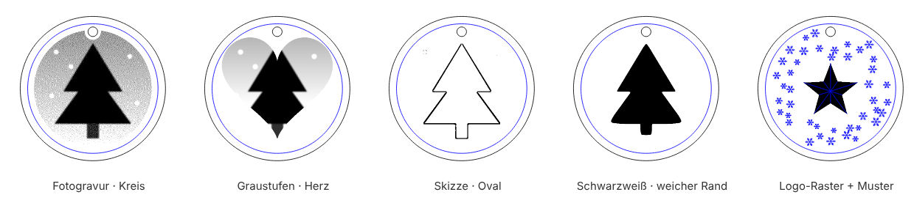
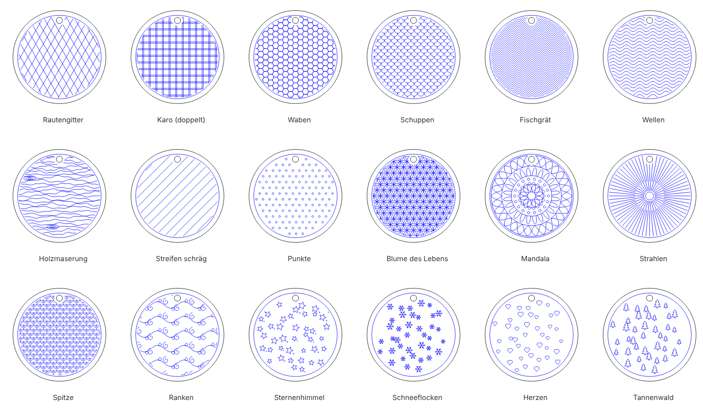

# Eigene Gravur: Fotos, Logos, Motive und Muster

Auf **jedes Teil jedes Modells** kannst du eigene Gravuren setzen: ein Foto, ein Logo, ein Motiv aus der
Bibliothek oder eines von 18 Flächenmustern. Das geht in der Browser-App, in Steckwerk Desktop und auf der
Kommandozeile. Eine Gravur läuft nie über einen Schnitt, einen Durchbruch oder eine Steckverbindung: was
über den Rand ragen würde, lässt Steckwerk weg oder blendet es aus.



## So geht's

Im Inspektor ganz unten steht der Abschnitt **Eigene Gravur** mit drei Knöpfen:

- **+ Foto/Logo** – wählt ein Bild aus der Bild-Bibliothek oder importiert ein neues. Es gehen JPG, PNG,
  HEIC vom iPhone und alles, was dein Mac anzeigen kann. Steckwerk verkleinert große Fotos beim Import auf
  1600 Pixel (für 16 cm bei 10 Punkten je mm genug), damit es auch auf älteren Rechnern flott bleibt.
- **+ Motiv** – ein Motiv aus der Motiv-Bibliothek (auch eigene SVG oder PNG).
- **+ Muster** – ein Flächenmuster, siehe unten.

Bis zu 8 Gravuren je Modell. Jede hat:

| Feld | Bedeutung |
| --- | --- |
| Auf Teil | größtes Teil (Standard), alle Teile, oder ein bestimmtes Teil des Modells |
| Größe | längere Seite in mm; 0 = passt sich dem Teil an. Bei Mustern: 0 = ganze Fläche |
| nach rechts / nach oben | Verschiebung gegenüber der Mitte des Teils |
| Drehung, Spiegeln | Spiegeln ist praktisch für Gravuren auf der Rückseite oder auf Acryl |
| Randabstand | Abstand zur Kontur und zu Durchbrüchen |

## Fotos und Logos (Bild-Gravur)

Fotos kommen als eigene Ebene **„Bild“** ins SVG (eingebettetes PNG in echter Größe in mm). Zusätzlich legt
Steckwerk jedes Bild als eigene PNG-Datei neben das SVG (`…_bild1_48x38mm.png`), falls ein Programm
eingebettete Bilder nicht übernimmt.

| Gravur | Wofür |
| --- | --- |
| Fotogravur (Punkte, fein) | Fotos. Steckwerk rastert selbst (Fehlerstreuung) – in XCS „Gravieren“ ohne weiteres Rastern |
| Graustufen (XCS rastert) | wenn du das Rasterverfahren in XCS wählen willst (z. B. Jarvis oder Stucki) |
| Schwarzweiß (Logo) | klare Logos und Scherenschnitte |
| Skizze (Konturen) | macht aus einem Foto eine Strichzeichnung |

Dazu **Bildform** (Rechteck, abgerundet, Oval, Kreis, Herz, weicher Rand), **Helligkeit**, **Kontrast**,
**Gamma**, **Umkehren** und die **Auflösung** (5 bis 12,7 Punkte je mm). Flaue Handyfotos streckt
Steckwerk automatisch auf vollen Tonwertumfang. Das fertige Bild wird zwischengespeichert: dieselben
Werte noch einmal kosten keine Rechenzeit.

Für den xTool M2: Startwert Pappel/Linde 3 mm, Bitmap gravieren, 10 W: Leistung 20 %, 200 mm/s,
Auflösung 10 Punkte/mm. Vorher am Rest testen, Holz ist sehr unterschiedlich.

## Motive als Gravur

| Gravur | Ergebnis |
| --- | --- |
| flächig, gestochen scharf (Bild) | das Motiv wird zur gefüllten Bild-Gravur – die sauberste Wahl für Logos |
| flächig (Schraffur) | gefüllt mit feinen Linien (Linienabstand einstellbar) |
| nur Umriss | nur die Kontur als Linie |

## Muster



Rautengitter, Karo, Waben, Schuppen, Fischgrät, Wellen, Holzmaserung, Streifen, Punkte, Blume des Lebens,
Mandala, Strahlen, Spitze, Ranken, Sternenhimmel, Schneeflocken, Herzen, Tannenwald. Der **Rapport** ist
die Größe eines Musterstücks (kleiner = feiner), die **Variante** würfelt gestreute Muster neu. Mit einer
Größe über 0 füllt das Muster nur einen Bereich (Rechteck, Kreis, Oval oder Herz). Hat ein Teil schon einen
Zierrahmen, bleibt das Muster innen; vorhandene Gravuren, Fotos und Motive spart es aus. Bei „alle Teile“
lässt Steckwerk Teile mit dichter Gravur (Dachziegel, Holzwand) aus.

## Kommandozeile

```bash
python3 cli.py --bild-import oma.jpg --bild-name "Oma"
python3 cli.py --bilder                       # Bild-Bibliothek, Muster und Rastermodi
python3 cli.py --model ornament --gravur '{"quelle": "bild", "bild": "oma-3f2a1c", "form": "oval"}' --out out
python3 cli.py --model wichtelhaus --gravur '{"quelle": "muster", "muster": "ranken", "teil": "alle"}' --out out
```

Fotos liegen unter `~/Library/Application Support/Steckwerk/Bilder` (Mac) bzw. `~/.steckwerk/bilder`, oder
im Ordner aus `$STECKWERK_BILDER`.

## Für Pakete

Pakete können die Bausteine direkt nutzen, siehe [Pakete](Pakete.md) und `PAKETE.md`:
`models._muster.muster(cv, "mandala", box, abstand)` füllt eine Leinwand mit einem Muster,
`gravur.anwenden(baugruppen, [...])` setzt Gravuren wie aus der Oberfläche, und `Part.images` nimmt
fertige Bild-Gravuren (`steckwerk.RasterImage`) auf.
