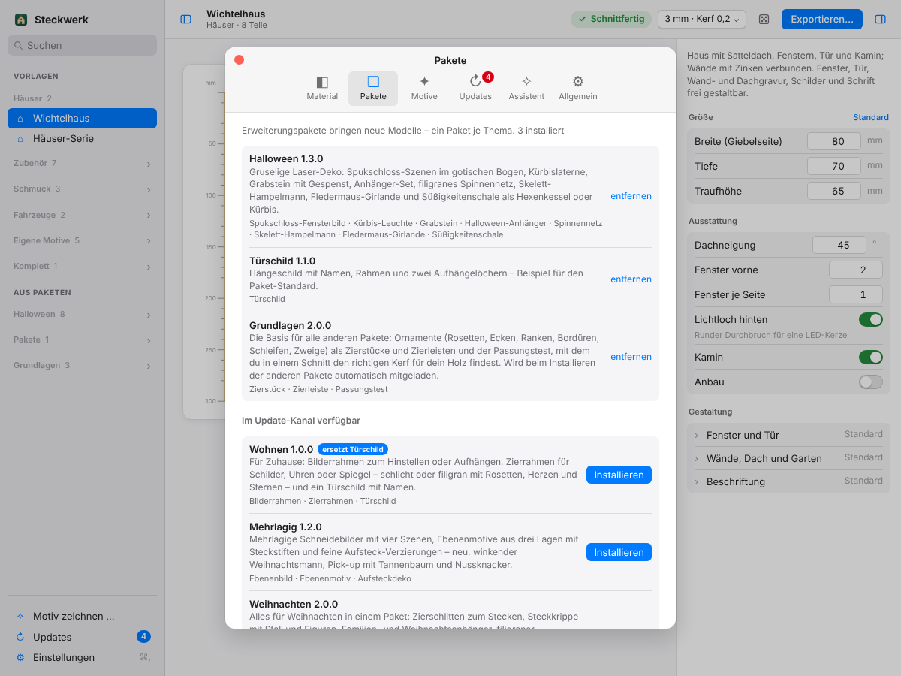
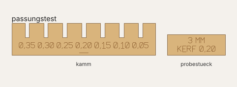
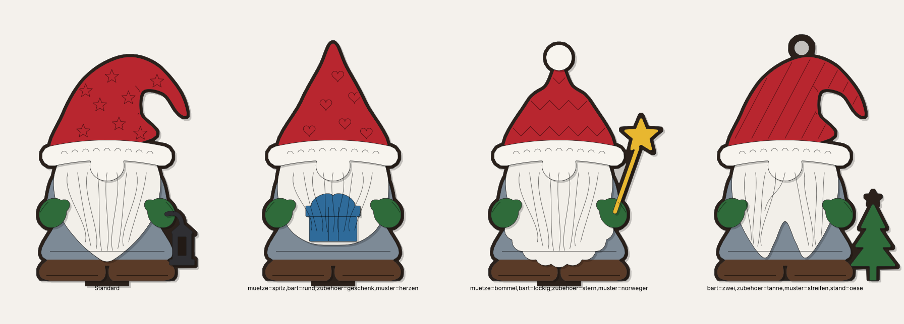
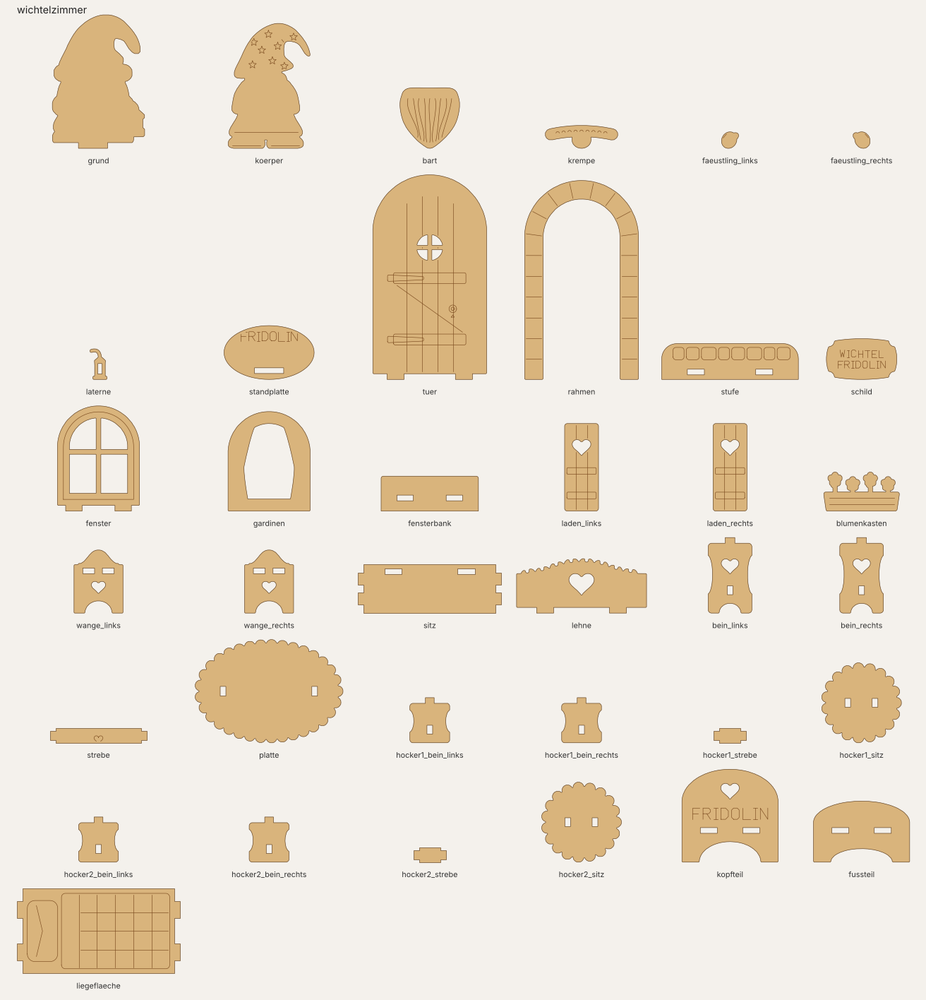
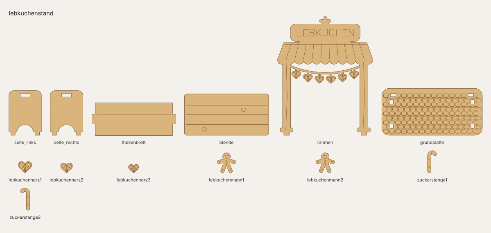

# Pakete

Mit Paketen kommen neue Modelle in Steckwerk, ohne die App neu zu installieren. Ein Paket ist eine
**`.swpaket`**-Datei (ein ZIP mit Ordner). Ältere `.lfpaket`-Dateien aus Laserforge-Zeiten funktionieren
weiter. Die vollständige Spezifikation steht in [PAKETE.md](https://github.com/chr-braun/steckwerk/blob/main/PAKETE.md) im Repo.

## Laden

- In der App: Einstellungen → **Pakete**. Dort siehst du jedes installierte Paket mit Beschreibung und
  seinen Modellen, und darunter alles, was es im Update-Kanal noch gibt – mit **Installieren**-Knopf.
  Eigene Dateien gehen über **Paket laden …**.
- Kommandozeile: `python3 cli.py --paket-installieren datei.swpaket`, `--pakete`, `--paket-entfernen ID`.



Beim Installieren wird jedes Modell mit Standardwerten gebaut und geprüft. Nur ein komplett
schnittfertiges Paket wird übernommen. „Grundlagen“ kommt automatisch mit.

> Pakete enthalten Python-Code, der mit deinen Rechten läuft. Lade nur Pakete aus Quellen, denen du
> vertraust.

## Unsere Pakete

Seit Steckwerk 2.6.0 gibt es **ein Paket je Thema**. Alte Einzelpakete räumt Steckwerk beim Installieren
selbst weg (Spalte „ersetzt“).

| Paket (ID) | Version | Was drin ist | ersetzt |
|---|---|---|---|
| **Grundlagen** (`verzierungen`) | 2.0.0 | Die Basis für alle anderen Pakete. **Zierstück** und **Zierleiste** mit Rosetten, Ecken, Ranken, Bordüren, Schleifen und Zweigen; **Passungstest**: Kamm mit Schlitzen in verschiedenen Breiten, unter dem Schlitz, in dem das Probestück satt sitzt, steht dein Kerf. Dazu die Ornament-Bibliothek, die alle Pakete nutzen. Kommt automatisch mit. | Verzierungen, Werkstatt |
| **Wohnen** (`wohnen`) | 1.0.0 | **Bilderrahmen** (9 × 13 bis 15 × 20 cm oder eigenes Maß, schlicht oder filigran, mit Sockel oder Schlüsselloch), **Zierrahmen** mit Schild und graviertem Text, **Türschild** mit Namen. | Umrandungen, Türschild |
| **Weihnachten** (`weihnacht`) | 2.0.0 | Zierschlitten mit Schnörkelkufen, Steckkrippe (Stall und Figuren), Familienanhänger, Weihnachtsanhänger, **Spitzenschmuck** (mit Muster-Rezepten und Zufallsmustern), **Scherenschnitt-Medaillon**, **Kristall-Schneeflocken**. Filigranes am besten mit den Profilen 1,5 / 2 mm. | Weihnachtsdeko, Filigran |
| **Halloween** (`halloween`) | 1.4.0 | Spukschloss im gotischen Bogen mit Hexe und Katze auf dem Besen, Kürbislaterne mit sieben geschnitzten Gesichtern, Grabstein mit Efeu und Gespenst, Anhänger-Set, Spinnennetz, Skelett (Hampelmann), Fledermausgirlande, Süßigkeitenschale – seit 1.4.0 alles fein gezeichnet. | – |
| **Mehrlagig** (`ebenen`) | 1.2.0 | **Ebenenbild**: Schattenbox mit 3–6 Lagen (Winterwald, Winterdorf, Spukschloss, Weihnachtsnacht). **Ebenenmotiv**: Motiv aus drei Lagen mit Steckstiften. **Aufsteckdeko**: Motive als Kantenreiter, Zapfen, Öse oder Spieß. | – |
| **Wichtel** (`wichtel`) | 1.0.1 | **Figur:** Schicht-Wichtel aus vier Lagen zum Bemalen. **Haus:** Wichteltür, Wichtelfenster. **Möbel:** Bank, Tisch mit Hockern, Bett. **Zubehör:** Leiter, Wegweiser, Wäscheleine. **Wichtelzimmer** auf Knopfdruck. **Wichtelmarkt:** Lebkuchenstand, Kreidetafel, Backstube, Briefkasten, Gartenzaun, Werkbank, Wegelaterne. Alles im selben Wichtel-Maßstab. | Wichtelmöbel, Wichteltür, Wichtelzubehör, Wichtelwelt, Wichtelfiguren |

Alle Paketdateien zum Herunterladen findest du unter [Downloads](Downloads.md). Jedes `.swpaket`
enthält den kompletten Quellcode – zum Ändern einfach entpacken.

## Vorschau

### Mehrlagig


### Weihnachten


### Halloween


### Grundlagen




### Wohnen


### Wichtel










### Wichtel-Maßstab

Jedes Wichtel-Modell hat oben die Auswahl **Maßstab**. Bei „passend zur Wichtelgröße“ gibst du nur die
Höhe deiner Wichtelfigur an (Standard 70 mm, wie die Wichtelfigur in Steckwerk), und alle Maße richten sich
danach. So passen Tür, Möbel und Zubehör zusammen. Bei „eigene Maße“ stellst du alles selbst ein.
Dickeres Holz braucht größere Wichtel: Bei 4 mm ab etwa 60 mm, bei 5 mm ab etwa 75 mm. Steckwerk sagt dir
die genaue Grenze.

## Eigenes Paket bauen

```bash
python3 cli.py --paket-neu krippe --out meine-pakete        # Vorlage mit Beispielmodell
python3 cli.py --paket-pruefen meine-pakete/krippe          # bauen + prüfen
python3 cli.py --paket-packen meine-pakete/krippe --out .   # → krippe-1.0.0.swpaket
```

Ein Paket besteht aus `paket.json` (id, name, version, modelle, optional `steckwerk`-Mindestversion,
`name_en`/`beschreibung_en`) und je Modell einer Python-Datei mit `INFO` (Formular) und `build(cfg, …)`.
Englische Texte kommen über ein `UEBERSETZUNG`-Wörterbuch. Seit 2.5.0 kann ein Paket alte Pakete
ablösen: `"ersetzt": ["altes_paket"]` räumt sie beim Installieren weg. Seit 2.4.0 kann ein Paket andere Pakete
nutzen: `"benoetigt": {"verzierungen": "1.0.0"}` in der `paket.json`, dann im Code
`Z = pakete.bibliothek("verzierungen")` – so stehen alle Ornamente und Steck-Werkzeuge zur Verfügung. Bei jeder Änderung die Version erhöhen und
über den [Update-Kanal](Updates.md) veröffentlichen.

## Was wir beim Bauen gelernt haben

Die aufwendigen Pakete (Mehrlagig, Weihnachten, Halloween) zeichnen Figuren als Plus/Minus-
Formen, rastern sie und machen daraus wieder saubere, laserfeste Konturen. Stolperfallen dabei:

- Ein Schnittschlitz über die ganze Breite teilt das Teil, und das kleinere Stück verschwindet still.
- Sehr dünne Überlappungen (unter ca. 1,3 mm) werden aufgemacht.
- Große Ebenenbilder (ca. 300 mm) brauchen etwa eine Minute zum Rechnen.
- Der Engel wirkt in kleinen Größen schwächer.
